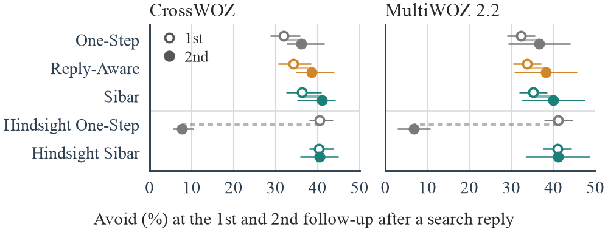
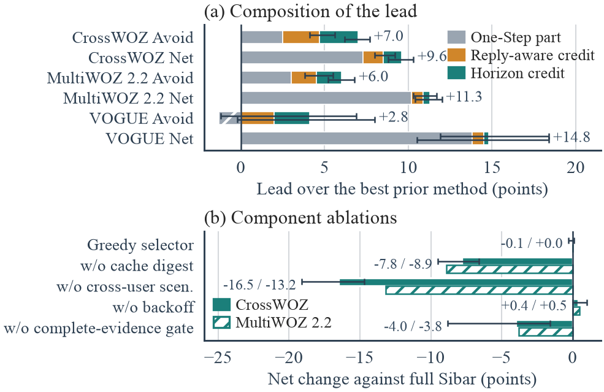
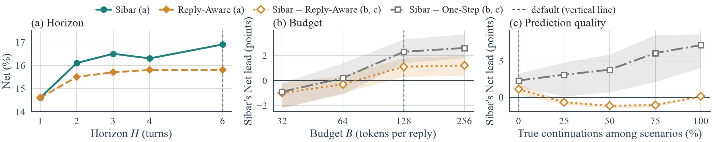
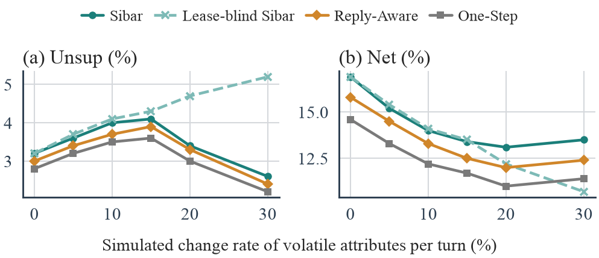

# Beyond the First Question: Multi-Step Information Bundling in Recommender Systems for User-Delegated Agents

This is the official code for the paper "Beyond the First Question: Multi-Step Information
Bundling in Recommender Systems for User-Delegated Agents".
The paper introduces **Sibar** (**S**peculative **I**nformation **B**undling for
**A**gent-mediated **R**ecommendation). When a recommendation service replies to a user's agent,
Sibar attaches a budgeted **packet** of facts about the recommended items. The agent can then
answer the owner's next follow-up questions from its cache instead of calling the service again.

Sibar works in four parts:
* It predicts what the owner will ask next from other owners' sessions.
* It credits a packet with every predicted need it serves within H turns.
* It selects the packet exactly, by branch and bound, within the per-reply token budget.
* It replans at every reply.

<p align="center">
  
</p>
<p align="center"><em>Follow-ups about two recommended hotels. A traditional recommender returns items only, so each question costs a call. Packets for the next question (One-Step) or up to the next reply (Reply-Aware) still miss transit. Sibar plans facts several questions ahead, so no follow-up needs a call.</em></p>

---

## 1. Repo overview

```
code/
  configs/default.yaml        # Paper defaults (Sec. 5.1, Appendix B)
  scripts/run.py              # Single entry point: one sub-command per table / figure
  scripts/run_all.sh          # Every experiment of Section 5 in sequence (tune -> test)
  sibar/
    types.py, catalog.py      # Data model: fact (e, a, v, s_f), need, turn, session; churn
    freshness.py              # Leases Δ(a), joint freshness φ, local value v_A (Def. 2)
    cache.py                  # Agent cache M, verified copies M✓_t, cache digest δ_t
    pool.py                   # C1  cache-aware fact pool F_t (Eq. 4)
    sampler.py, encoder.py,
    roles.py                  # C2  cross-user trajectory sampler (HNSW + backoff chain)
    planner.py                # C3  V_H / V_H^ra / one-step credit, branch and bound + LP bound (Eq. 6)
    agent.py                  # C4  verified cache, complete-evidence gate, usability head, answer check
    policies.py               # Sibar, internal controls, Reply-Only and the five adapted prior methods
    simulator.py              # Whole-session replay (Algorithm 1, lines 6-13)
    metrics.py                # Avoid, Unsup, Tok, Net; paired seeker bootstrap
    analysis.py               # Follow-up run statistics and coverage@4 (Table 4)
    data/                     # CrossWOZ, MultiWOZ 2.2, VOGUE and synthetic loaders
    llm/                      # OpenAI-compatible backend (OpenRouter or local vLLM) with disk cache
  tests/                      # Example 1, Proposition 1, Proposition 3 (B&B optimality)
  figures/                    # Figures from the paper used in this README
  docs/                       # Method-to-code map and replay protocol details
```

## 2. Method recap

Sibar has four components. `docs/method.md` maps each one to its file and equation.

<p align="center">
  
</p>
<p align="center"><em>Sibar between a recommendation service and a user's agent. At each reply the service gathers facts the agent lacks or must refresh (C1), predicts the next turns from similar past sessions (C2) and sends the packet with the highest expected net saving within the budget (C3). The agent answers from valid facts or calls back (C4).</em></p>

| Symbol | Component | What it does | Code |
|--------|-----------|--------------|------|
| `C1` | Cache-aware pool | Gathers facts about the recommended items, skips static facts the agent already holds, attaches leases from catalog update rates, and caps the pool at `M = 32`. | `pool.py` |
| `C2` | Cross-user trajectory sampler | Retrieves the `S = 16` nearest past reply states (HNSW over multilingual MiniLM embeddings) and turns their continuations into scenarios of the next turns. The backoff chain `α = N/(N+η)` covers sparse states. | `sampler.py` |
| `C3` | Receding-horizon planner | Credits a packet with the predicted needs it serves within `H` turns, discounted by `γ`, and selects it exactly within budget `B` by branch and bound with an LP bound. | `planner.py` |
| `C4` | Verified agent cache | Answers locally only from complete, lease-valid evidence when `v_A ≥ 0`. Otherwise it calls the service. | `agent.py` |

The methods compared in Section 5 (`sibar/experiment.py`):

| Group | Methods |
|-------|---------|
| Floor | `Reply-Only` |
| Prior methods, adapted to fact packets | `Compact-Record`, `CFQP-Pkg`, `Spec-Action`, `Trace-Bundle`, `ProAct-Pkg` |
| Internal controls (same pool, scenarios and selector; differ only in credit) | `One-Step`, `Reply-Aware`, `Sibar` |
| Hindsight (true continuation as the only scenario) | `Hindsight One-Step`, `Hindsight Sibar` |

### Replay loop (ASCII)

```
                ┌──────────────────────────────────────────────────────────┐
  turn t of  ──►│ search turn : the service replies with the answer        │
  a logged      │ follow-up   : agent answers from cache if Suff·I[v_A≥0]  │
  session       │               holds, else it calls (a call is a reply)   │
                │ every reply : C1 pool → C2 scenarios → C3 packet P_t     │
                │               (c(P_t) ≤ B), cached with leases            │
                └──────────────────────────────────────────────────────────┘
                          │  later turns follow the log
                          ▼
             per session: correct / wrong local answers, calls, packet tokens
             → Avoid, Unsup, Tok, Net (ΔJ as % of calling on every follow-up)
```

The loop is implemented in `sibar/simulator.py`.

## 3. Environment

| Component | Requirement | Tested with |
|-----------|-------------|-------------|
| Python | ≥ 3.10 | 3.11 |
| NumPy | ≥ 2.0 | 2.4.6 |
| SciPy (HiGHS LP) | ≥ 1.11 | 1.17.1 |
| scikit-learn | ≥ 1.3 | 1.9.1 |
| hnswlib | ≥ 0.8 | 0.8.0 |
| sentence-transformers | ≥ 3.0 | 6.2.0 |
| PyTorch | any recent | 2.14.1 |
| tiktoken / transformers | ≥ 0.7 / any | 0.14.0 / 5.20.2 |
| openai SDK | ≥ 1.0 | 3.37.0 |
| vLLM *(optional, local agent)* | — | 0.22.1 |

* The GPU is only used by the state encoder and the optional local LLM server. The planner runs on CPU.
* The first run downloads the encoder `paraphrase-multilingual-MiniLM-L12-v2` from HuggingFace.
* Without network access, pass `--encoder hash`.

## 4. Install

```bash
conda create -n sibar python=3.11 -y && conda activate sibar
pip install -r requirements.txt
cp .env.example .env
```

Environment variables (`.env`, git-ignored):

| Variable | Purpose | Default |
|----------|---------|---------|
| `AGENT_BACKEND` | Frozen agent (C4): `oracle` (deterministic, no API) or `openrouter` (any OpenAI-compatible endpoint). | `oracle` |
| `AGENT_MODEL`, `AGENT_BASE_URL` | Agent model id and endpoint. | `qwen/qwen-2.5-72b-instruct`, OpenRouter |
| `PREDICTOR_BACKEND`, `PREDICTOR_MODEL`, `PREDICTOR_BASE_URL` | LLM for the `ProAct-Pkg` baseline (`oracle` = label-frequency stand-in). | `oracle` |
| `OPENROUTER_API_KEY` | Key for the endpoint. It must be non-empty for `openrouter`; a local server ignores its value. | *(unset)* |
| `SIBAR_TOKENIZER` | Tokenizer for fact costs `c(f)`: a tiktoken encoding or a HuggingFace id. | `cl100k_base` |

**Paper protocol.** The agent is Qwen2.5-14B-Instruct at temperature 0, and tokens are counted
with its own tokenizer. OpenRouter does not serve the 14B model, so serve it locally:

```bash
vllm serve Qwen/Qwen2.5-14B-Instruct --port 8765 --max-model-len 8192 --seed 0
```

Then uncomment the "Paper protocol" block of `.env.example` in your `.env`.

Every completion is cached in `.cache/llm_cache.sqlite`, so repeated replays and reruns cost no
extra calls.

## 5. Datasets

| Name | Source | Split | Place raw files in |
|------|--------|-------|--------------------|
| CrossWOZ | [thu-coai/CrossWOZ](https://github.com/thu-coai/CrossWOZ) | train/val/test merged, split by seeker; 20% of training seekers as dev | `data/raw/crosswoz_repo/` |
| MultiWOZ 2.2 | [budzianowski/multiwoz](https://github.com/budzianowski/multiwoz) | official split; each dialogue is a bootstrap unit | `data/raw/multiwoz_repo/` |
| VOGUE | [D3Mlab/vogue](https://github.com/D3Mlab/vogue) | leave-one-seeker-out | `data/raw/vogue/vogue.json` |

```bash
mkdir -p data/raw && cd data/raw
git clone --depth 1 https://github.com/thu-coai/CrossWOZ.git crosswoz_repo
git clone --depth 1 https://github.com/budzianowski/multiwoz.git multiwoz_repo
cd ../..
python scripts/run.py prepare --dataset crosswoz     # -> data/processed/crosswoz.pkl
python scripts/run.py prepare --dataset multiwoz
```

* **CrossWOZ.** Seekers are assigned to train or test by a salted SHA-256 hash of the seeker id,
  so the split is stable and needs no split files.
* **VOGUE.** Download the dialogues from the link above. Their hand grounding is not part of this repo; convert them to the
  JSON format documented in `sibar/data/vogue.py`.
* **Turn labels.** Turns are labeled from dialogue acts as described in Appendix B.
* `docs/protocol.md` gives the exact rules: turn labels, follow-ups whose need is unresolved,
  logged replies, facts and their token costs.

## 6. How to run

`scripts/run.py` is the single entry point. Each sub-command reproduces one table or figure and
writes to `outputs/<dataset>/`. Results are not tracked in git.

| Command | Paper | Output |
|---------|-------|--------|
| `runs` | Table 4 (follow-up runs, coverage@4) | `table4_runs.json` |
| `tune [--param budget\|horizon\|churn]` | `H`, `γ` chosen on the dev split (Appendix B) | `tune*.json` |
| `main` | Table 5, Fig. 3 | `main.jsonl`, `table5_main.json` |
| `reprice` | Table 6 (re-prices the packets of `main`) | `table6_reprice.json` |
| `ablation` | Fig. 4b | `fig4b_ablation.json` |
| `sweep --param horizon\|budget\|oracle_mix\|gamma` | Fig. 5 | `fig5_<param>.json` |
| `churn` | Fig. 6 | `fig6_churn.json` |
| `latency` | planning latency per reply | console |

Run `tune` before `main`, because `main` reads the tuned `H` and `γ` from `tune.json`:

```bash
python -m pytest -q tests                                   # Example 1, Prop. 1, Prop. 3
python scripts/run.py runs --dataset crosswoz
python scripts/run.py tune --dataset crosswoz --replays 5 --workers 16
python scripts/run.py main --dataset crosswoz --replays 40 --workers 16
python scripts/run.py reprice --dataset crosswoz
```

| Flag | Meaning |
|------|---------|
| `--dataset` | `crosswoz`, `multiwoz`, `vogue` or `synthetic`. |
| `--replays` | Replays per session over seeds (paper: 40; default 1). |
| `--workers` | Worker processes. |
| `--max-sessions` | Subsample test sessions for a quick run (0 = all). |
| `--methods` | Comma-separated subset of methods for `main`. |
| `--config` | YAML config (default `configs/default.yaml`). |
| `--encoder` | Override the state encoder (`hash` runs offline). |

### Full pipeline

```bash
bash scripts/run_all.sh 32 40                 # [workers] [replays]; logs in outputs/logs/
FROM=crosswoz_main bash scripts/run_all.sh    # resume from a step
PY=/path/to/python bash scripts/run_all.sh    # pick the interpreter
```

`main` prints one row per method plus the paired contrasts against `Sibar`, for example:

```
Method                   Avoid   Unsup     Tok     Net   Calls   Net 95% CI
Reply-Only                 ...
...
Sibar                      ...
Sibar - One-Step: Avoid +.. [.., ..]  Net +.. [.., ..]
Sibar - Reply-Aware: Avoid +.. [.., ..]  Net +.. [.., ..]
```

## 7. Metrics and protocol

* **Avoid**: the share of follow-ups answered locally and correctly.
* **Unsup**: the share answered locally with a wrong or unsupported answer.
* **Tok**: packet tokens per session.
* **Net**: `ΔJ` (Eq. 2) as a percentage of the cost of calling on every follow-up.
* **Costs**: `C_call = 1`, `C_err = 2`, `λ = 0.0012` per token and `C_pred = 0.038` per non-empty packet, with budget `B = 128`.
* **Intervals**: 1,000 paired bootstrap resamples over seekers, or over dialogues for MultiWOZ, scaled by `t_{G−1,0.975}/z_{0.975}`.

`docs/protocol.md` covers the rest:
* the agent prompt (question, last answer and cached facts) and the citation check;
* how the usability head is fit;
* how each prior method is adapted, including its send gate;
* the implementation choices the paper leaves open.

## 8. Reproduced results from the paper

The tables below restate the reproduced results.

Unless noted, all numbers are from the paper's protocol:
* Qwen2.5-14B-Instruct agent, `B = 128`, `C_call = 1`, `C_err = 2`, `λ = 0.0012`, `C_pred = 0.038`.
* 40 replays per session.
* Avoid, Unsup and Net are percentages. Tok is packet tokens per session. Brackets are 95% paired bootstrap intervals.
* **Bold** = best non-hindsight method.

### RQ1 — Follow-up runs and planning horizons (Table 4, Fig. 3)

<p align="center">
  
</p>
<p align="center"><em>Avoid at the first (open) and second (filled) follow-up after a search reply (95% intervals; hindsight rows are given the true continuation).</em></p>

| Statistic (CrossWOZ) | Value |
|---|---:|
| Search turns / follow-ups | 21,237 / 23,427 |
| Follow-ups two or more turns after a search reply (%) | 30.0 |
| First follow-ups followed directly by a second, all / held-out (%) | 42.2 / 39.7 |
| Search replies followed by ≥ 1 / ≥ 2 / ≥ 3 follow-ups (%) | 77.2 / 32.6 / 0.5 |
| Coverage@4 from the reply state, need 1 / need 2 (%) | 44.4 / 58.6 |
| Held-out cases, need 1 / need 2 | 1,566 / 621 |

Avoid at the 1st / 2nd follow-up after a search reply (Fig. 3):

| Method | CrossWOZ | MultiWOZ 2.2 |
|---|---:|---:|
| One-Step | 32.0 / 36.2 | 32.3 / 36.6 |
| Reply-Aware | 34.2 / 38.6 | 33.8 / 38.2 |
| Sibar | 36.3 / 41.1 | 35.2 / 40.0 |
| Hindsight One-Step | 40.5 / 7.8 | 41.2 / 6.8 |
| Hindsight Sibar | 40.3 / 40.5 | 41.0 / 41.1 |

### RQ2 — Whole-session comparison (Table 5)

| Method | CW Avoid | CW Unsup | CW Tok | CW Net | MW Avoid | MW Unsup | MW Tok | MW Net | VG Avoid | VG Unsup | VG Tok | VG Net |
|---|---:|---:|---:|---:|---:|---:|---:|---:|---:|---:|---:|---:|
| Reply-Only | 4.1 | 0.0 | 0 | 0.0 | 3.0 | 0.0 | 0 | 0.0 | 5.3 | 0.0 | 0 | 0.0 |
| Compact-Record | 26.4 | 2.4 | 562 | −5.8 | 25.5 | 2.5 | 227 | −18.6 | 36.0 | 2.7 | 331 | −23.8 |
| CFQP-Pkg | 27.2 | 3.2 | 211 | 6.1 | 26.6 | 3.5 | 80 | 1.3 | 28.5 | 4.0 | 136 | −8.4 |
| Spec-Action | 27.9 | 3.2 | 252 | 5.3 | 27.3 | 3.4 | 96 | −0.2 | 28.7 | 4.2 | 166 | −12.4 |
| Trace-Bundle | 27.0 | 3.5 | 353 | 0.2 | 26.3 | 3.6 | 137 | −7.2 | 28.0 | 4.0 | 240 | −21.4 |
| ProAct-Pkg | 30.7 | 3.2 | 284 | 7.3 | 30.0 | 3.4 | 105 | 2.0 | 32.0 | 4.0 | 171 | −7.7 |
| One-Step | 33.2 | 2.8 | 169 | 14.6 | 33.0 | 3.0 | 59 | 12.2 | 34.7 | 3.5 | 88 | 6.1 |
| Reply-Aware | 35.4 | 3.0 | 188 | 15.8 | 34.5 | 3.1 | 63 | 12.9 | 36.7 | 3.7 | 97 | 6.8 |
| **Sibar** | **37.7** | 3.2 | 213 | **16.9** | **36.0** | 3.3 | 69 | **13.3** | **38.8** | 4.0 | 109 | **7.1** |
| Hindsight One-Step | 31.2 | 2.6 | 27 | 18.5 | 35.3 | 3.2 | 9 | 21.4 | 33.3 | 4.0 | 14 | 13.0 |
| Hindsight Sibar | 40.4 | 3.5 | 34 | 25.7 | 41.0 | 3.8 | 12 | 25.6 | 42.7 | 4.0 | 18 | 22.1 |

Sibar's lead over the internal controls:

| Contrast | Dataset | Avoid | Net |
|---|---|---:|---:|
| Sibar − One-Step | CrossWOZ | +4.5 [3.6, 5.7] | +2.3 [1.4, 3.3] |
| Sibar − Reply-Aware | CrossWOZ | +2.3 [1.5, 3.0] | +1.1 [0.3, 1.8] |
| Sibar − One-Step | MultiWOZ 2.2 | +3.0 [2.1, 4.2] | +1.1 [0.2, 2.2] |
| Sibar − Reply-Aware | MultiWOZ 2.2 | +1.5 [0.7, 2.3] | +0.4 [−0.5, 1.1] |
| Sibar − One-Step | VOGUE | +4.1 [−0.8, 10.6] | +1.0 [−4.1, 6.8] |
| Sibar − Reply-Aware | VOGUE | +2.1 [−2.2, 6.0] | +0.3 [−4.0, 3.9] |

On CrossWOZ, Sibar makes 1.42 fewer calls per session than Reply-Only, about 596 ms of round trips.

### Other cost constants (Table 6)

Net on CrossWOZ when each planner's default packets are re-priced:

| Setting | One-Step | Reply-Aware | Sibar | Sibar − Reply-Aware |
|---|---:|---:|---:|---:|
| λ = 0.0003 | 18.6 | 20.2 | **21.9** | +1.7 [0.8, 2.2] |
| λ = 0.0006 | 17.2 | 18.7 | **20.2** | +1.5 [0.7, 2.1] |
| λ = 0.0012 | 14.6 | 15.8 | **16.9** | +1.1 [0.3, 1.8] |
| λ = 0.0024 | 9.3 | 9.9 | **10.2** | +0.3 [−0.7, 1.0] |
| C_err = 1 | 17.4 | 18.8 | **20.1** | +1.3 [0.5, 2.0] |
| C_err = 4 | 9.0 | 9.8 | **10.5** | +0.7 [0.0, 1.2] |
| C_pred = 0.01 | 17.3 | 18.5 | **19.6** | +1.1 |
| C_pred = 0.1 | 8.7 | 9.8 | **10.9** | +1.1 |

C_pred charged at every reply, including replies that send nothing:

| Dataset | One-Step | Reply-Aware | Sibar |
|---|---:|---:|---:|
| CrossWOZ | 12.0 | 13.3 | **14.5** |
| MultiWOZ 2.2 | −3.5 | −2.7 | **−2.2** |
| VOGUE | −6.3 | −5.5 | **−5.0** |

### RQ3 — Sources of the gain (Fig. 4)

<p align="center">
  
</p>
<p align="center"><em>(a) Sources of Sibar's lead over the best prior method (hatched: negative). (b) Net change without each part (hatched: MultiWOZ 2.2). Whiskers: 95% intervals.</em></p>

| Variant (CrossWOZ) | Avoid | Unsup | Tok | Net | Sibar − variant, Net |
|---|---:|---:|---:|---:|---:|
| Sibar | 37.7 | 3.2 | 213 | 16.9 | — |
| Greedy selector | 37.5 | 3.2 | 211 | 16.8 | +0.1 [−0.1, 0.3] |
| w/o cache digest | 33.5 | 2.8 | 323 | 9.1 | +7.8 [6.6, 9.5] |
| w/o cross-user scenarios | 5.5 | 0.1 | 8 | 0.4 | +16.5 [14.7, 19.1] |
| w/o backoff | 37.9 | 3.2 | 208 | 17.3 | −0.4 [−1.0, 0.0] |
| w/o complete-evidence gate | 37.7 | 5.2 | 213 | 12.9 | +4.0 [1.6, 8.8] |

### RQ4 — Horizon, budget and prediction quality (Fig. 5)

<p align="center">
  
</p>
<p align="center"><em>Net saving on CrossWOZ by (a) planning horizon, and Sibar's lead over its one-step and reply-aware configurations by (b) reply budget and (c) prediction quality (95% bands; dashed line: default).</em></p>

Net on CrossWOZ by planning horizon:

| H | Reply-Aware | Sibar | Sibar − Reply-Aware | Latency (ms/reply) |
|---|---:|---:|---:|---:|
| 1 | 14.6 | 14.6 | +0.0 | 12.0 |
| 2 | 15.5 | 16.1 | +0.6 [0.3, 1.1] | 12.4 |
| 3 | 15.7 | 16.5 | +0.8 [0.3, 1.4] | 5.7 |
| 4 | 15.8 | 16.3 | +0.5 [0.0, 1.1] | 13.3 |
| 6 | 15.8 | 16.9 | +1.1 [0.3, 1.8] | 13.4 |

Net by reply budget, with configurations re-tuned on dev for each budget:

| B | One-Step | Reply-Aware | Sibar | Sibar − One-Step | Sibar − Reply-Aware |
|---|---:|---:|---:|---:|---:|
| 32 | 5.0 | **5.1** | 4.1 | −0.9 [−2.2, −0.2] | −1.0 [−2.2, −0.2] |
| 64 | 12.1 | **12.6** | 12.3 | +0.2 [−1.1, 1.4] | −0.3 [−1.0, 0.4] |
| 128 | 14.6 | 15.8 | **16.9** | +2.3 [1.4, 3.3] | +1.1 [0.3, 1.8] |
| 256 | 15.5 | 16.9 | **18.1** | +2.6 [1.8, 3.7] | +1.2 [0.4, 2.0] |

Net by prediction quality, i.e. the share of scenarios replaced by the true continuation:

| Oracle mix | One-Step | Reply-Aware | Sibar | Sibar − One-Step | Sibar − Reply-Aware |
|---|---:|---:|---:|---:|---:|
| 0% | 14.6 | 15.8 | **16.9** | +2.3 [1.4, 3.3] | +1.1 [0.3, 1.8] |
| 25% | 22.5 | **26.3** | 25.6 | +3.1 [0.1, 4.8] | −0.7 [−1.1, −0.5] |
| 50% | 22.4 | **27.4** | 26.2 | +3.8 [0.7, 5.9] | −1.2 [−1.5, −1.1] |
| 75% | 21.4 | **28.6** | 27.5 | +6.1 [2.1, 8.6] | −1.1 [−1.4, −0.9] |
| 100% | 18.5 | 25.6 | **25.7** | +7.2 [4.1, 8.7] | +0.1 [0.0, 0.2] |

### RQ5 — Catalog churn and leases (Fig. 6)

<p align="center">
  
</p>
<p align="center"><em>(a) Wrong local answers (Unsup) and (b) net saving on CrossWOZ as catalog facts change faster.</em></p>

Unsup / Net on CrossWOZ as volatile facts change with a per-turn probability:

| Churn | One-Step | Reply-Aware | Lease-blind Sibar | Sibar | Sibar − Lease-blind, Net |
|---|---:|---:|---:|---:|---:|
| 0% | 2.8 / 14.6 | 3.0 / 15.8 | 3.2 / 16.9 | 3.2 / 16.9 | +0.0 [0.0, 0.0] |
| 5% | 3.2 / 13.3 | 3.4 / 14.5 | 3.7 / 15.4 | 3.6 / 15.2 | −0.2 [−0.5, 0.1] |
| 10% | 3.5 / 12.2 | 3.7 / 13.3 | 4.1 / 14.1 | 4.0 / 14.0 | −0.1 [−0.5, 0.4] |
| 15% | 3.6 / 11.7 | 3.9 / 12.5 | 4.3 / 13.5 | 4.1 / 13.4 | −0.1 [−0.8, 0.4] |
| 20% | 3.0 / 11.0 | 3.3 / 12.0 | 4.7 / 12.2 | 3.4 / 13.1 | +0.9 [−1.2, 2.7] |
| 30% | 2.2 / 11.4 | 2.4 / 12.4 | 5.2 / 10.7 | 2.6 / 13.5 | +2.8 [0.7, 4.6] |

## 9. License

MIT License.

