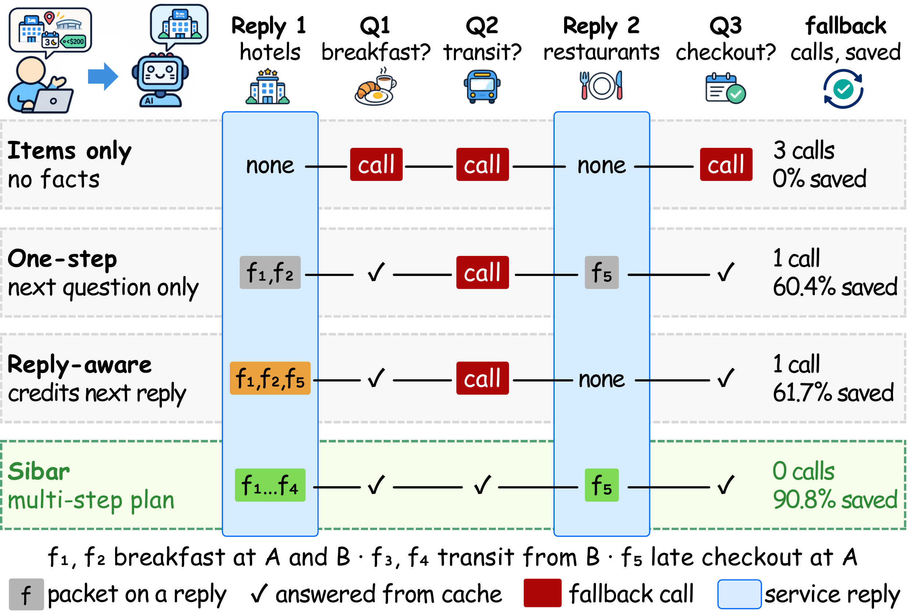
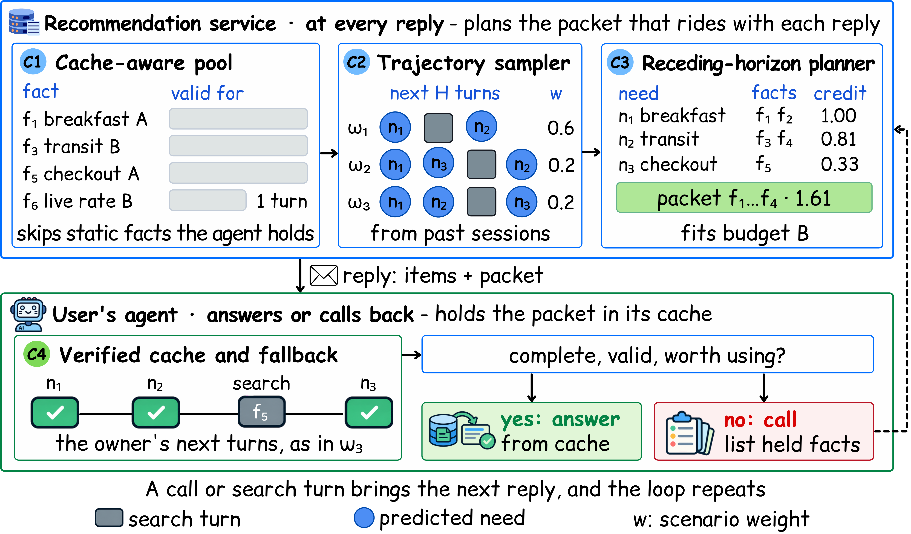

# Sibar

Official code for **Beyond the First Question: Multi-Step Information Bundling in Recommender Systems for User-Delegated Agents**.

When a recommendation service replies to a user's agent, the owner usually asks a few follow-up
questions about the recommended items: the price, whether breakfast is included, how to get there.
Each one costs the agent another call to the service. Sibar (Speculative Information Bundling for
Agent-mediated Recommendation) attaches a small packet of facts to every reply, so the agent can
answer the next few follow-ups from its cache instead.

<p align="center">
  
</p>

## 1. Method

Sibar has four components. `docs/method.md` maps each one to its equations in the paper.

| Component | What it does | Code |
|---|---|---|
| **C1** Cache-aware pool | Collects facts about the recommended items, drops static facts the agent already has, attaches a lease to each fact based on how often the catalog changes, and keeps at most `M = 32` facts. | `pool.py` |
| **C2** Cross-user trajectory sampler | Finds the `S = 16` most similar past reply states (HNSW over multilingual MiniLM embeddings) and uses what happened next in those sessions as scenarios. A backoff chain handles states with few neighbors. | `sampler.py` |
| **C3** Receding-horizon planner | Scores a packet by the predicted needs it serves within `H` turns, discounted by `γ`, and finds the best packet under budget `B` by branch and bound with an LP bound. | `planner.py` |
| **C4** Verified agent cache | Answers a follow-up locally only when every fact it needs is cached and still within its lease. Otherwise the agent calls the service. | `agent.py` |

To choose the packet, Sibar looks at what other owners asked next in similar sessions. It gives a
packet credit for every predicted need it covers within the next H turns, then picks the best packet
that fits the per-reply token budget with branch and bound. It plans again at every reply.

<p align="center">
  
</p>

The experiments replay logged sessions turn by turn (`sibar/simulator.py`). On a follow-up the agent
either answers from its cache or calls the service, and every reply, including those calls, comes
with a new packet. At the end we count correct and wrong local answers, calls and packet tokens.

We compare against the following methods (`sibar/experiment.py`):

- `Reply-Only`: no packet, every follow-up is a call.
- Prior methods adapted to fact packets: `Compact-Record`, `CFQP-Pkg`, `Spec-Action`, `Trace-Bundle`, `ProAct-Pkg`.
- Internal controls that share Sibar's pool, scenarios and selector but credit packets differently: `One-Step`, `Reply-Aware`.
- Hindsight versions that use the true continuation as the only scenario: `Hindsight One-Step`, `Hindsight Sibar`.

## 2. Installation

Python 3.10 or newer is required. We tested with Python 3.11.

```bash
conda create -n sibar python=3.11 -y
conda activate sibar
pip install -r requirements.txt
cp .env.example .env
```

The planner runs on CPU. A GPU only helps the state encoder and the optional local LLM server. The
first run downloads `paraphrase-multilingual-MiniLM-L12-v2` from HuggingFace. If you have no network
access, pass `--encoder hash`.

### Configuring the agent

By default everything runs offline with a deterministic oracle agent, so you do not need an API key
to try the code. The main variables in `.env` are:

| Variable | Purpose | Default |
|---|---|---|
| `AGENT_BACKEND` | `oracle` (no API calls) or `openrouter` (any OpenAI-compatible endpoint) | `oracle` |
| `AGENT_MODEL`, `AGENT_BASE_URL` | Agent model and endpoint | `qwen/qwen-2.5-72b-instruct`, OpenRouter |
| `PREDICTOR_BACKEND`, `PREDICTOR_MODEL`, `PREDICTOR_BASE_URL` | LLM used by the `ProAct-Pkg` baseline | `oracle` |
| `OPENROUTER_API_KEY` | API key. Must be non-empty for `openrouter`, but a local server ignores its value | unset |
| `SIBAR_TOKENIZER` | Tokenizer for fact costs: a tiktoken encoding or a HuggingFace model id | `cl100k_base` |

In the paper, the agent is Qwen2.5-14B-Instruct at temperature 0, and tokens are counted with its own
tokenizer. OpenRouter does not serve this model, so we run it locally with vLLM:

```bash
vllm serve Qwen/Qwen2.5-14B-Instruct --port 8765 --max-model-len 8192 --seed 0
```

Then uncomment the "Paper protocol" block in your `.env`. All completions are cached in
`.cache/llm_cache.sqlite`, so reruns do not repeat API calls.

## 3. Datasets

We use three dialogue datasets. They are not included in this repository.

| Dataset | Source | Split | Put raw files in |
|---|---|---|---|
| CrossWOZ | [thu-coai/CrossWOZ](https://github.com/thu-coai/CrossWOZ) | All splits merged, then split by seeker. 20% of training seekers form the dev set. | `data/raw/crosswoz_repo/` |
| MultiWOZ 2.2 | [budzianowski/multiwoz](https://github.com/budzianowski/multiwoz) | Official split | `data/raw/multiwoz_repo/` |
| VOGUE | [D3Mlab/vogue](https://github.com/D3Mlab/vogue) | Leave-one-seeker-out | `data/raw/vogue/vogue.json` |

```bash
mkdir -p data/raw && cd data/raw
git clone --depth 1 https://github.com/thu-coai/CrossWOZ.git crosswoz_repo
git clone --depth 1 https://github.com/budzianowski/multiwoz.git multiwoz_repo
cd ../..
python scripts/run.py prepare --dataset crosswoz   # writes data/processed/crosswoz.pkl
python scripts/run.py prepare --dataset multiwoz
```

CrossWOZ seekers are assigned to train or test by a salted SHA-256 hash of the seeker id, so the
split is the same on every machine and needs no split files. For VOGUE, download the dialogues and
convert them to the JSON format described in `sibar/data/vogue.py`. The hand grounding of VOGUE is
not part of this repository.

Turns are labeled from dialogue acts (Appendix B of the paper). `docs/protocol.md` has the exact
rules for turn labels, unresolved follow-ups, logged replies, facts and token costs.

## 4. Running the experiments

`scripts/run.py` has one sub-command per table or figure. Results go to `outputs/<dataset>/`.

| Command | Paper | Output |
|---|---|---|
| `runs` | Table 4 (follow-up runs, coverage@4) | `table4_runs.json` |
| `tune [--param budget\|horizon\|churn]` | Choice of `H` and `γ` on the dev split (Appendix B) | `tune*.json` |
| `main` | Table 5, Fig. 3 | `main.jsonl`, `table5_main.json` |
| `reprice` | Table 6 | `table6_reprice.json` |
| `ablation` | Fig. 4b | `fig4b_ablation.json` |
| `sweep --param horizon\|budget\|oracle_mix\|gamma` | Fig. 5 | `fig5_<param>.json` |
| `churn` | Fig. 6 | `fig6_churn.json` |
| `latency` | Planning time per reply | printed to the console |

`main` reads the tuned `H` and `γ` from `tune.json`, so run `tune` first. For CrossWOZ:

```bash
python scripts/run.py runs    --dataset crosswoz
python scripts/run.py tune    --dataset crosswoz --replays 5 --workers 16
python scripts/run.py main    --dataset crosswoz --replays 40 --workers 16
python scripts/run.py reprice --dataset crosswoz
```

`main` prints Avoid, Unsup, Tok, Net and Calls for each method, followed by the paired differences
between Sibar and the two internal controls with 95% bootstrap intervals.

Useful flags:

- `--dataset`: `crosswoz`, `multiwoz`, `vogue` or `synthetic`.
- `--replays`: replays per session over different seeds. The paper uses 40 and the default is 1.
- `--workers`: number of worker processes.
- `--max-sessions`: use only this many test sessions for a quick check. `0` means all.
- `--methods`: comma-separated subset of methods for `main`.
- `--config`: YAML config. The default is `configs/default.yaml`, which holds the paper settings.
- `--encoder`: override the state encoder. `hash` works offline.

To run every experiment in Section 5 in order:

```bash
bash scripts/run_all.sh 32 40                 # 32 workers, 40 replays; logs go to outputs/logs/
FROM=crosswoz_main bash scripts/run_all.sh    # resume from a given step
PY=/path/to/python bash scripts/run_all.sh    # use a different Python
```

## 5. Tests

```bash
python -m pytest -q tests
```

The tests check Example 1 from the paper, Proposition 1, and Proposition 3 (the branch and bound
always returns the optimal packet).

## 6. Repository structure

```
configs/default.yaml   paper settings (Section 5.1, Appendix B)
scripts/run.py         entry point, one sub-command per table or figure
scripts/run_all.sh     all experiments of Section 5 in order
sibar/
  types.py, catalog.py         facts, needs, turns, sessions and catalog churn
  freshness.py                 leases, joint freshness and the agent's local value
  cache.py                     agent cache and cache digest
  pool.py                      C1 cache-aware fact pool
  sampler.py, encoder.py,
  roles.py                     C2 cross-user trajectory sampler
  planner.py                   C3 packet credit, branch and bound with LP bound
  agent.py                     C4 verified cache and answer check
  policies.py                  Sibar, internal controls, Reply-Only and adapted prior methods
  simulator.py                 session replay
  metrics.py                   Avoid, Unsup, Tok, Net and the paired bootstrap
  analysis.py                  follow-up run statistics and coverage@4
  data/                        CrossWOZ, MultiWOZ 2.2, VOGUE and synthetic loaders
  llm/                         OpenAI-compatible backend with a disk cache
tests/                 Example 1, Proposition 1, Proposition 3
docs/                  method-to-code map and replay protocol
assets/                figures used in this README
```
